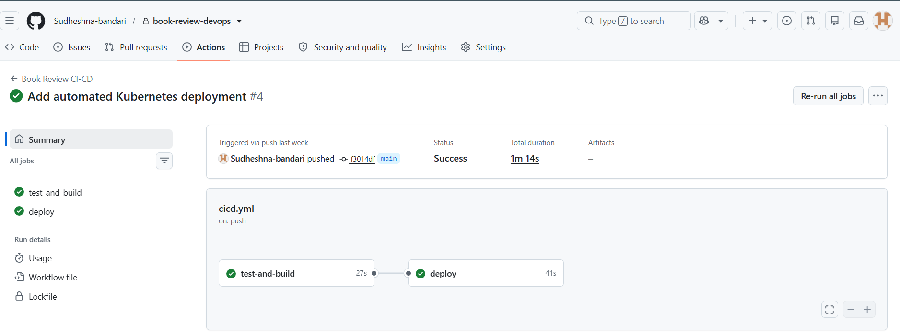
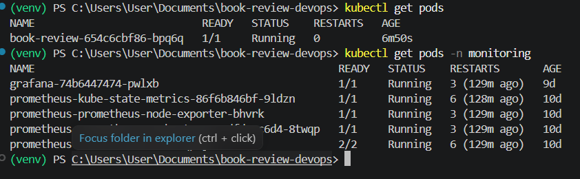
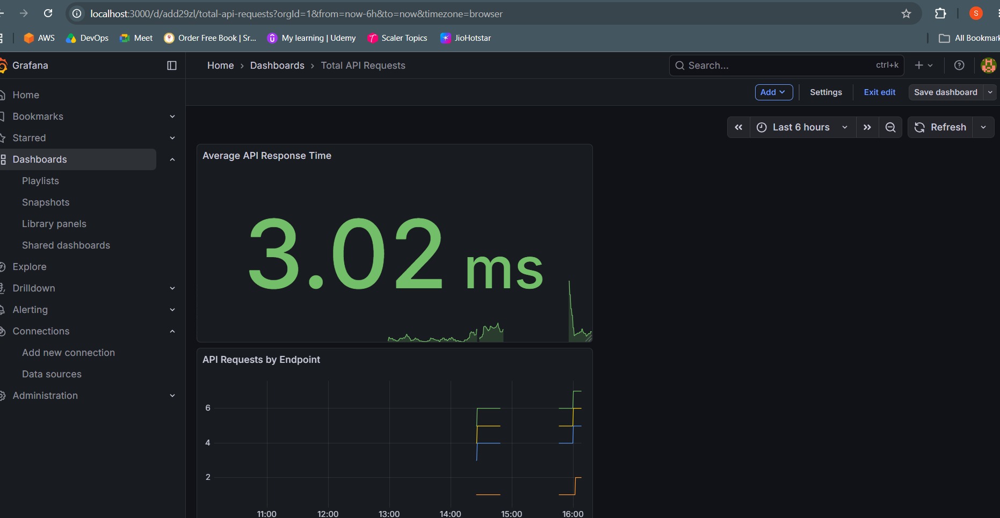
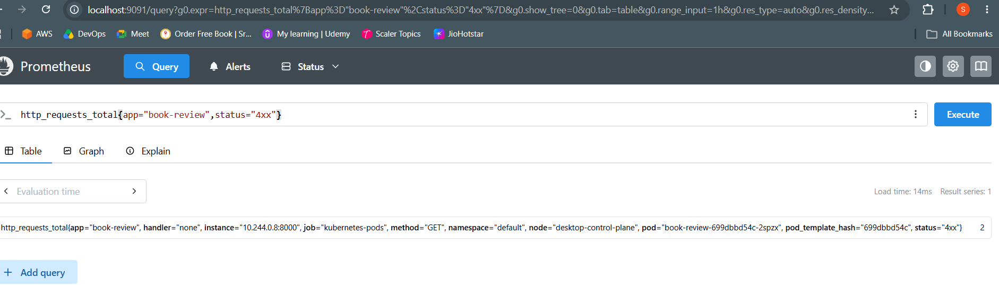

# Book Review Application -- End-to-End DevOps Project

## Project Overview

This project demonstrates an end-to-end DevOps workflow for a
containerized Book Review REST API built with Python and FastAPI.

The application is packaged with Docker and deployed to a local
Kubernetes cluster running through Docker Desktop. GitHub Actions
automates testing, image building, and deployment through a self-hosted
Windows runner. Prometheus collects application metrics, and Grafana
provides monitoring dashboards.

The project also includes Amazon ECR for storing a Docker image and
Terraform configuration for verifying AWS account identity.

> **Deployment note:** The Kubernetes deployment in this project runs
> locally on Docker Desktop. The application image was also pushed to
> Amazon ECR. Terraform was used to verify AWS account identity; it was
> not used to provision production infrastructure or an AWS Kubernetes
> cluster.

## Technology Stack

  Category                  Technologies
  ------------------------- -----------------------------------------
  Programming language      Python
  Backend framework         FastAPI
  API testing               pytest
  Containerization          Docker
  Container orchestration   Kubernetes (Docker Desktop)
  Cloud platform            AWS
  Container registry        Amazon Elastic Container Registry (ECR)
  Infrastructure as Code    Terraform
  CI/CD                     GitHub Actions
  CI/CD deployment runner   Self-hosted Windows runner
  Metrics collection        Prometheus
  Monitoring dashboards     Grafana
  Package management        Helm
  Version control           Git and GitHub

## Project Architecture

``` text
Developer
   |
   v
GitHub Repository
   |
   v
GitHub Actions CI/CD
   |
   +----> Install dependencies and run pytest
   |
   +----> Build Docker image
   |
   v
Self-hosted Windows runner
   |
   v
Local Kubernetes cluster (Docker Desktop)
   |
   v
FastAPI Book Review Application
   |
   +----> Exposes /metrics
                |
                v
            Prometheus
                |
                v
             Grafana
```

Amazon ECR is used as a container image registry. Terraform is
configured with the AWS provider and used to retrieve AWS account
identity information.

## Project Features

### 1. FastAPI Application

-   Developed REST API endpoints for book management.
-   Implemented endpoints to retrieve, add, and delete books.
-   Added an application health-check endpoint.
-   Integrated the Prometheus FastAPI Instrumentator.
-   Exposed application metrics through the `/metrics` endpoint.

### 2. Docker Containerization

-   Created a Dockerfile for the FastAPI application.
-   Installed application dependencies in the container image.
-   Built Docker images with versioned tags.
-   Used Docker Desktop for local container development and testing.

### 3. Kubernetes Deployment

-   Created Kubernetes Deployment and Service manifests.
-   Deployed the application to a local Kubernetes cluster running on
    Docker Desktop.
-   Configured a NodePort service for application access.
-   Added pod annotations for Prometheus metrics scraping.
-   Checked pod status, deployment status, and service configuration
    using `kubectl`.

### 4. AWS ECR and Terraform

-   Created an Amazon ECR repository.
-   Built and pushed the application Docker image to Amazon ECR.
-   Configured Terraform with the AWS provider.
-   Used the AWS caller identity data source to retrieve and verify AWS
    account identity.
-   Practiced Infrastructure as Code fundamentals without provisioning
    additional AWS infrastructure.

### 5. CI/CD Pipeline with GitHub Actions

Implemented a GitHub Actions workflow to automate:

-   Checking out the source code.
-   Setting up Python.
-   Installing application dependencies.
-   Running automated tests using `pytest`.
-   Building the Docker image.
-   Deploying the application to Kubernetes using a self-hosted Windows
    runner.
-   Verifying the Kubernetes rollout status.

The deployment job runs on the self-hosted runner, which has access to
the local Docker Desktop Kubernetes cluster.

### 6. Prometheus Monitoring

-   Installed Prometheus using Helm in the Kubernetes `monitoring`
    namespace.
-   Configured Kubernetes pod discovery for annotated application pods.
-   Enabled application metrics scraping from the `/metrics` endpoint.
-   Monitored HTTP requests, response codes, and request duration.
-   Verified that the application metrics target was being scraped.

The application pod uses these Prometheus annotations:

``` yaml
prometheus.io/scrape: "true"
prometheus.io/path: "/metrics"
prometheus.io/port: "8000"
```

### 7. Grafana Dashboards

Installed Grafana using Helm and connected it to Prometheus as its data
source.

Created monitoring visualizations for:

1.  Total API Requests
2.  HTTP Error Count
3.  API Requests by Endpoint
4.  Average API Response Time

Validated monitoring by generating successful API requests and
intentional HTTP 404 responses.

## Application Endpoints

  Method   Endpoint             Description
  -------- -------------------- --------------------------------
  GET      `/`                  Application home
  GET      `/health`            Application health check
  GET      `/books`             Retrieve all books
  GET      `/books/{book_id}`   Retrieve a specific book
  POST     `/books`             Add a new book
  DELETE   `/books/{book_id}`   Delete a book
  GET      `/metrics`           Prometheus application metrics

## Project Structure

``` text
book-review-devops/
│
├── app/
│   └── main.py
│
├── tests/
│
├── k8s/
│   └── deployment.yaml
│
├── terraform/
│   └── main.tf
│
├── .github/
│   └── workflows/
│       └── cicd.yml
│
├── screenshots/
│   ├── github-actions.png
│   ├── kubernetes-pods.png
│   ├── grafana-dashboard.png
│   └── prometheus-targets.png
│
├── Dockerfile
├── requirements.txt
├── .gitignore
└── README.md
```

## How to Run the Application Locally

### Prerequisites

-   Python 3.12
-   Git

### Step 1: Clone the repository

``` bash
git clone https://github.com/Sudheshna-bandari/book-review-devops.git
cd book-review-devops
```

### Step 2: Create a virtual environment

``` bash
python -m venv venv
```

Activate it in Windows PowerShell:

``` powershell
.\venv\Scripts\Activate.ps1
```

### Step 3: Install dependencies

``` bash
pip install -r requirements.txt
```

### Step 4: Start the application

``` bash
uvicorn app.main:app --reload
```

### Step 5: Access the application

-   Application: http://localhost:8000
-   Swagger API documentation: http://localhost:8000/docs
-   Health endpoint: http://localhost:8000/health
-   Prometheus metrics: http://localhost:8000/metrics

If port `8000` is already in use, stop the process using it or start the
application on another port, for example:

``` bash
uvicorn app.main:app --reload --port 8001
```

## Docker

Build the Docker image from the project root:

``` bash
docker build -t book-review-app:1.0 .
```

Run the container:

``` bash
docker run --name book-review-container -p 8000:8000 book-review-app:1.0
```

Open http://localhost:8000/docs to access the API documentation.

## Kubernetes Deployment

The Kubernetes manifests are stored in the `k8s/` directory. Apply the
configuration:

``` bash
kubectl apply -f k8s/deployment.yaml
```

Check the deployment:

``` bash
kubectl get deployments
```

Check application pods:

``` bash
kubectl get pods
```

Check services:

``` bash
kubectl get services
```

The application is deployed to the local Docker Desktop Kubernetes
cluster. The service is configured as a NodePort service.

## Monitoring Setup

### Prometheus

Prometheus was installed using Helm in the `monitoring` namespace.
Kubernetes pod discovery uses the annotations configured on the
application pod to identify the metrics endpoint.

The application exposes metrics at:

``` text
/metrics
```

### Grafana

Grafana was installed using Helm and configured with Prometheus as its
data source.

The dashboards display total API requests, HTTP errors, requests grouped
by endpoint, and average API response time.

## Testing and Validation

The project was validated through:

-   FastAPI endpoint checks.
-   Automated tests using `pytest`.
-   Docker image build verification.
-   Kubernetes deployment, pod, and service checks.
-   GitHub Actions CI/CD workflow execution.
-   Kubernetes rollout status verification.
-   Prometheus target health verification.
-   Application metrics collection.
-   Grafana dashboard validation.
-   HTTP 404 error generation and monitoring.

## Screenshots

The following screenshots document the project workflow and monitoring
setup. Add the corresponding image files to the `screenshots/` directory
using the filenames shown below.

### CI/CD Pipeline



### Kubernetes Deployment



### Grafana Monitoring Dashboard



### Prometheus Targets



## Skills Demonstrated

-   Python and REST API development.
-   FastAPI application development.
-   Docker image creation and containerization.
-   Kubernetes deployments, services, and pod management.
-   AWS ECR image registry operations.
-   Terraform and AWS provider fundamentals.
-   CI/CD pipeline implementation using GitHub Actions.
-   Self-hosted GitHub Actions runner configuration.
-   Git and GitHub version control.
-   Prometheus metrics collection.
-   Grafana dashboard creation.
-   Helm-based tool installation.
-   Troubleshooting and deployment validation.

## Future Enhancements

-   Integrate persistent database storage for book records.
-   Add Kubernetes resource and application alerts.
-   Add application availability and latency alerts.
-   Deploy the application to AWS-managed infrastructure.
-   Introduce centralized logging.
-   Implement production-grade secrets management.

## Author

**Sudheshna Bandari**

-   GitHub: https://github.com/Sudheshna-bandari
-   Project Repository:
    https://github.com/Sudheshna-bandari/book-review-devops
